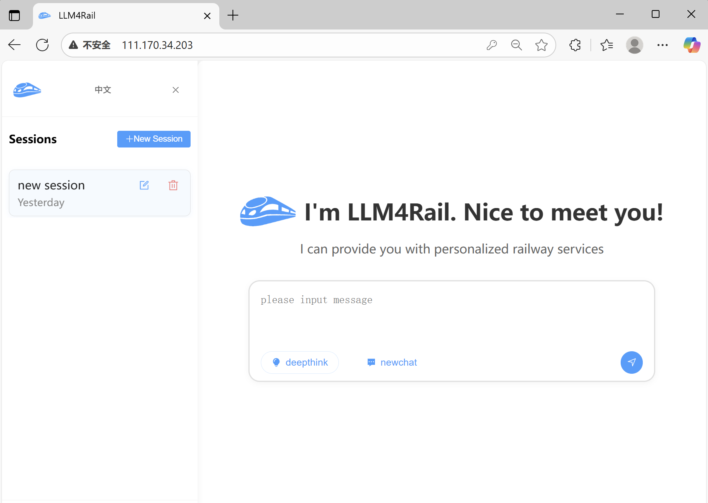
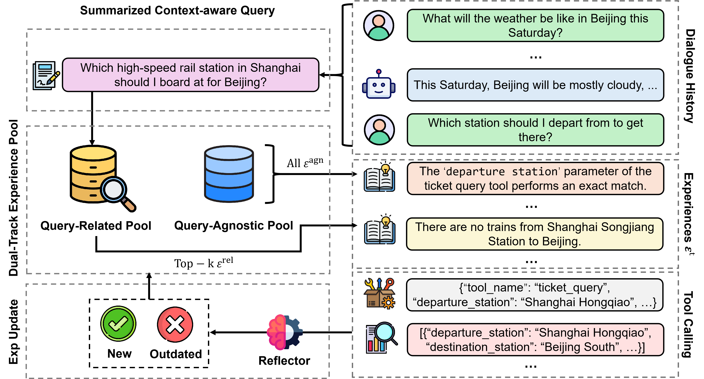
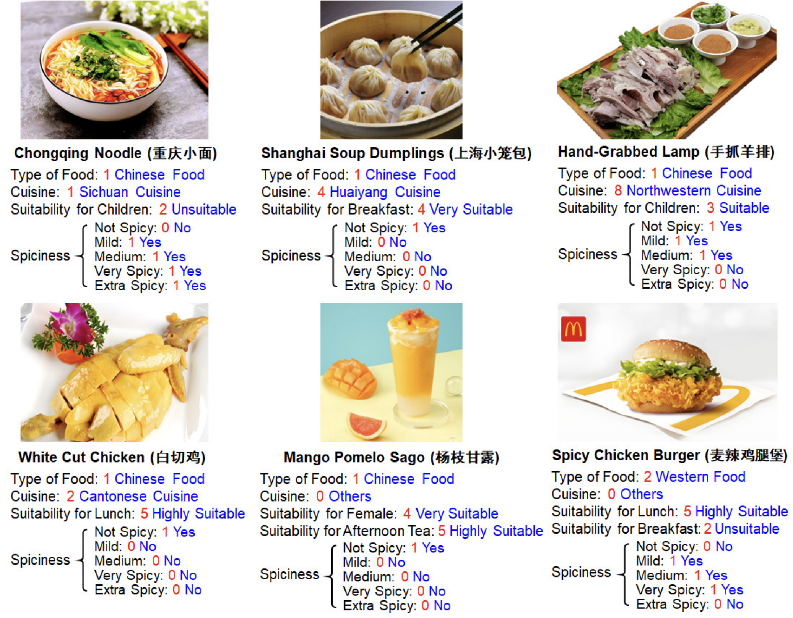
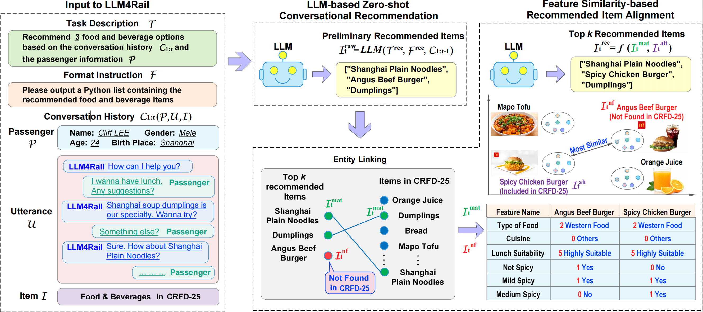

# LLM4Rail
This repo provides the source code & data of our paper: [LLM4Rail: An LLM-Augmented Personalized Railway Service Consulting Platform](www.baidu.com) ().

# 🔍 Introduction
## 1.LLM4Rail
We implement LLM4Rail, a novel LLM-augmented railway service consulting platform.
LLM4Rail consists of four core modules: <br>
* **🚅Ticketing:** Provide up-to-date train ticket information, connection options and other travel suggestions. <br>
* **🌭Meal:** Provide tailored food and beverage recommendations. <br>
* **🌧Weather:** Provide the latest weather forecasts. <br>
* **😄Chit-chat:** Chat for general questions and assistance.

<!-- Illustration of LLM4Rail -->


## 2.ER-QTAO Framework
We propose the “**E**xperience-**R**etrieval **Q**uestion-**T**hought-**A**ction-**O**bservation (**ER-QTAO**)” prompting framework, which contains two key machanims to improve tool use.

<!-- Illustration of QTAO -->
<div align="center"></div>
<div align="center">An illustration of the Experience Storage and Retrieval (ESR) mechanism</div>

## 3.CRFD-25
We also introduce the **C**hinese **R**ailway **F**ood and **D**rink ([CRFD-25](https://anonymous.4open.science/r/CRFD25)) dataset. 

<!-- Illustration of the CRFD dataset -->
<div align="center"></div>
<div align="center">An illustration of the CRFD dataset</div>

<br>

## 4. LLM-based Zero-Shot CRS with LLM-Guided Item Alignment
Based on the CRFD dataset, we develop a
novel LLM-based algorithm for zero-shot conversational recommendation. This approach leverages LLM-guided item alignment  to ensure all suggested items are grounded in the provided dataset.

<!-- Illustration of Food & Drink Recommendation -->
<div align="center"></div>
<div align="center">An illustration of the LLM-based zero-shot conversational recommeandation</div>


# 📌 Website

You can get started with LLM4Rail on its official website: http://111.170.34.203/

# 🚀 Requirements

- Python == 3.12
- openai == 1.97.0
- numpy == 1.26.4
- pandas  == 2.2.3
- levenshtein == 0.27.1
- scikit-learn == 1.6.1
- tqdm == 4.67.1
- transformers == 4.49.0

# 🌟 Evaluation

## 1. Set Working Directory
Set the working directory to the project root.
```bash
cd <your project path>
```

## 2. Set Environment Variable
Set PYTHONPATH environment variable to the project's root directory.
```bash
export PYTHONPATH=<your project path>
```

## 3. Generate Test Queries
Run the script `evaluation/<task>/query_generator.py`.
```bash
python evaluation/<task>/query_generator.py
```
`<task>`: `weather` or `ticket` <br>
If you want to evaluate recommendation module, skip this step.

## 4. Evaluate Weather/Ticket Inquiry Module 🌧🚅
Run the script `evaluation/<task>/evaluate.py`.
```bash
python evaluation/<task>/evaluate.py \
--model <model> \
--userFile dataset/user.csv \
--config evaluation/<task>/config.json \
--saveDir evaluation/<task>/save/ \
--GPTKey <your GPT key> \
-QwenKey <your Qwen key> \
-amapKey <your amap Key>
```
`<model>`: `qwen-3` or `gpt-4o` <br>

## 5. Evaluate Food & Drink Recommendation Module 🍔
Run the script `evaluation/meal/evaluate.py`.
```bash
python evaluation/meal/evaluate.py \
--model <model> \
--rec_model <rec_model> \
--topk <k> \
--config evaluation/meal/config.json \
--saveDir evaluation/meal/save/ \
--GPTKey <your GPT key> \
-QwenKey <your Qwen key> \
```
`<model>`: `qwen-3` or `gpt-4o` <br>
`<rec_model>`: `zero-shot` or `feature-augmented` <br>

## 6. Analysis The Results
Run the script `evaluation/<task>/analysis/analysis.py`. <br>
```bash
python evaluation/<task>/analysis/analysis.py --saveDir evaluation/<task>/save [--rec_model <rec_model>]
```
`<task>`: `weather`, `ticket` or `meal` <br>
`<rec_model>`: `zero-shot` or `feature-augmented` (only needed when `<task>`=`meal`) <br>
